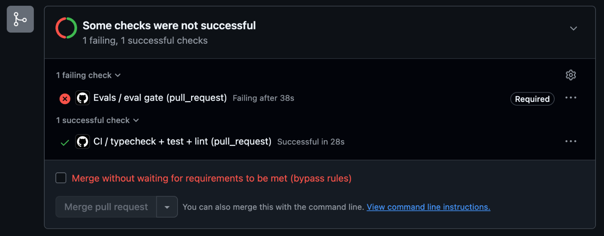

# Tala

[](https://github.com/DonSuavvy/tala-voice-agent/actions/workflows/ci.yml)

A Taglish-first AI voice agent for tier-1 customer support at **Kidlat
Fiber**, a fictional Philippine fiber internet provider. Callers talk to Tala
in English, Tagalog or Taglish, and she does the work through tools: she
verifies identity, checks outages by barangay, confirms GCash/Maya payments,
runs modem diagnostics, books technicians and applies bill credits. A live
supervisor console lets a human watch each call, guide Tala privately, approve
credits and take over.

Tala's core is the agent engine from
[OpsPilot](https://github.com/DonSuavvy/opspilot), extended for real-time voice.

> **Status: first text call.** Tala answers a call by text. She opens with
> the AI and recording disclosure, verifies the caller, and tells them about
> an outage in their barangay. She runs on OpsPilot's engine
> ([ADR 1](docs/adr/0001-import-opspilot-engine.md)) with the Kidlat Fiber
> company pack ([ADR 2](docs/adr/0002-company-packs-are-data.md)). No voice
> yet. The full design is in [`docs/DESIGN.md`](docs/DESIGN.md), the domain
> language in [`GLOSSARY.md`](GLOSSARY.md), and the spec and tickets in this
> repo's [Issues](https://github.com/DonSuavvy/tala-voice-agent/issues/1).

## Development

Needs Node 26 (see `.nvmrc`) and npm.

```bash
npm install
npm run typecheck
npm test
npm run lint
```

`npm test` needs no database and no API key. Copy `.env.example` to
`.env.local` only when a ticket needs a real service.

| Workspace | Package | Role |
|---|---|---|
| `packages/core` | `@tala/core` | The framework-free brain: OpsPilot's engine plus voice extensions |
| `packages/packs/kidlat-fiber` | `@tala/kidlat-fiber` | The Kidlat Fiber company pack |
| `packages/evals` | `@tala/evals` | Eval harness, simulated callers, advisory grader |
| `apps/agent` | `@tala/agent` | LiveKit Agents worker |
| `apps/web` | `@tala/web` | Caller page and supervisor console |
| `apps/voice-gateway` | `@tala/voice-gateway` | Hand-built voice path, local only |

### Talk to Tala

`npm run chat` is a phone call typed in a terminal. It needs
`ANTHROPIC_API_KEY` in `.env.local` (first-party API only) and spends real
credit. Each run caps its own spend at $0.50. It runs Sonnet 5.5, the
development default; a scenario 1 call costs about 2 cents on Sonnet and 4 on
Opus (live runs, 2026-11-06).

Tala's words stream as she says them. Type a line while she is still talking
and press Enter to cut in: she stops, the call keeps only what she had said,
and your line is the next caller turn. `/exit` or `/quit` hangs up. On
Windows PowerShell, use `npm.cmd` if `npm.ps1` is blocked.

```bash
npm run chat
```

```bash
npm run chat -- --model haiku
```

Try scenario 1: say there is no internet, then give account `8012345601` and
the mobile ending `0101`. The other test accounts are in
[`world.json`](packages/packs/kidlat-fiber/pack/world.json).
`npm run verify:first-call` plays the same call with a scripted caller and
checks the trace.

### Run the evals

`npm run eval` plays each eval case against Tala on real Claude. A simulated
caller (Sonnet 5.5) talks to her through the same call session the chat and
the voice paths use, and every call is scored by deterministic checks: how the
call ended, which tools ran, the disposition, no account data before
verification, and a line before every tool call. An advisory Claude grade for
tone, Taglish and politeness is printed beside the result and never decides
it. Each run prints its actual cost (about 4 cents a case on Sonnet) and saves
a report pinned to the pack, SOP, prompt, policy, model and git commit in
[`packages/evals/reports/`](packages/evals/reports).

```bash
npm run eval
```

```bash
npm run eval:diff -- packages/evals/reports/<before>.json packages/evals/reports/<after>.json
```

The diff lists what regressed, was fixed, was added, was removed or stayed the
same. On pull requests the suite runs as the `eval gate` check, which is
required on `main`. A pull request that told Tala never to end the call was
blocked by it:



How the repo is checked: [`docs/FAILURES.md`](docs/FAILURES.md) logs what
broke, [`docs/REVIEWS.md`](docs/REVIEWS.md) records review passes, and
[`docs/SECURITY.md`](docs/SECURITY.md) is the threat model.

## License

MIT, see [LICENSE](LICENSE).
